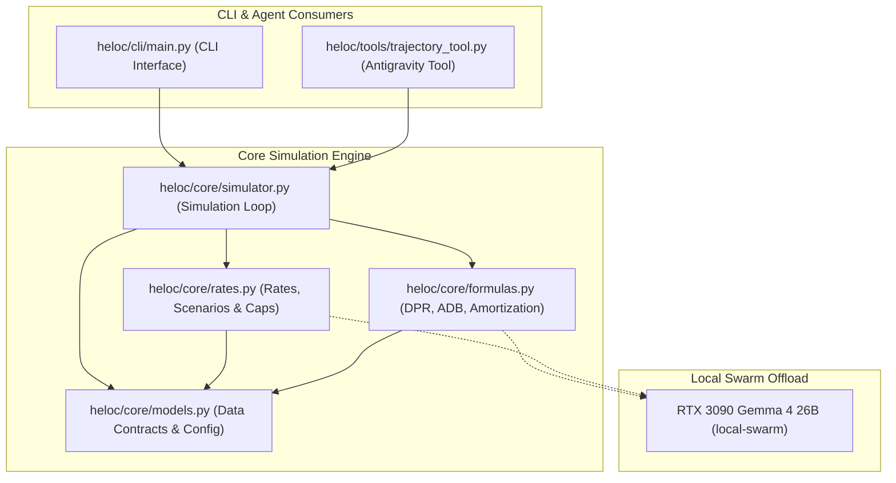

# HELOC Simulation Engine & Antigravity Tool Implementation Plan

> **For agentic workers:** REQUIRED SUB-SKILL: Use superpowers:subagent-driven-development to implement this plan task-by-task. Steps use checkbox (`- [x]`) syntax for tracking.

**Goal:** Build a robust, localized Home Equity Line of Credit (HELOC) simulation engine in Python featuring interest-only draw accounting (ADB/365/360), dynamic repayment re-amortization, payment shock modeling, Washington State usury cap enforcement (WAC 208-620-235), comparative prepayment tracking, an interactive CLI, and Google Antigravity AI agent tool callables.

**Architecture:** A modular, layered system separating financial domain models and mathematical formulas from stateful lifecycle simulation loops. An agent integration layer exposes type-annotated callables to Antigravity AI agents, and a CLI provides rich terminal reporting. Small, focused Python modules are designed to enable local offload via the on-device Gemma 4 26B model (`local-swarm`) for docstring authoring, typing, and test-driven fixes.

**Architecture Diagram:**



**Tech Stack:**
- Python 3.12+
- Pydantic v2
- Pandas (for tabular time-series export)
- Pytest (for test-driven verification)
- Local Swarm (`scripts/local-task.ps1` & `scripts/swarm-fix.ps1`) for on-device Gemma 4 26B tasks

**Spec:** [docs/superpowers/specs/2026-10-10-heloc-calculator-engine-design.md](file:///c:/github/agy/heloc/docs/superpowers/specs/2026-10-10-heloc-calculator-engine-design.md)

## Global Constraints
- Target workspace root: `c:\github\agy\heloc`
- Python environment: Python 3.12 (`python`)
- Test framework: `pytest`
- Regulatory ceiling: Washington Consumer Loan Act (WAC 208-620-235) maximum 25.0% simple interest per annum
- Clean type hints and docstrings on all exported functions and models
- Frequent atomic git commits per task step

---

### Task 1: Package Scaffolding & Pytest Setup

**Files:**
- Create: `pyproject.toml`
- Create: `heloc/__init__.py`
- Create: `tests/__init__.py`
- Create: `tests/conftest.py`

**Interfaces:**
- Produces: Package installation and clean test runner execution.

- [x] **Step 1: Write the failing test**
Create `tests/test_scaffolding.py`:
```python
def test_package_import():
    import heloc
    assert hasattr(heloc, "__version__")
    assert heloc.__version__ == "0.1.0"
```

- [x] **Step 2: Run test to verify it fails**
Run: `python -m pytest tests/test_scaffolding.py -v`
Expected: FAIL with `ModuleNotFoundError: No module named 'heloc'` or `AttributeError: module 'heloc' has no attribute '__version__'`.

- [x] **Step 3: Write minimal implementation**
Create `pyproject.toml`:
```toml
[build-system]
requires = ["setuptools>=61.0"]
build-backend = "setuptools.build_meta"

[project]
name = "heloc-calculator"
version = "0.1.0"
description = "Localized HELOC Simulation Engine and Antigravity Agent Tool"
readme = "Python HELOC APR Calculator.md"
requires-python = ">=3.10"
dependencies = [
    "pydantic>=2.0",
    "pandas>=1.5"
]

[project.optional-dependencies]
dev = [
    "pytest>=8.0"
]

[tool.setuptools.packages.find]
where = ["."]
include = ["heloc*"]
```
Create `heloc/__init__.py`:
```python
"""Localized HELOC Simulation Engine & Antigravity Agent Tool."""

__version__ = "0.1.0"
```
Create empty `tests/__init__.py` and `tests/conftest.py`.

- [x] **Step 4: Run test to verify it passes**
Run: `python -m pytest tests/test_scaffolding.py -v`
Expected: PASS (1 passed).

- [x] **Step 5: Commit**
```bash
git add pyproject.toml heloc/__init__.py tests/__init__.py tests/conftest.py tests/test_scaffolding.py
git commit -m "chore: scaffold project structure and packaging configuration"
```

---

### Task 2: Core Domain Models & Data Contracts

**Files:**
- Create: `heloc/core/__init__.py`
- Create: `heloc/core/models.py`
- Create: `tests/test_models.py`

**Interfaces:**
- Consumes: Pydantic v2
- Produces: `BalanceMethod`, `YearBasis`, `RateScenarioType`, `HelocConfig`, `MonthlyRecord`, `TrajectorySummary`

- [x] **Step 1: Write the failing test**
Create `tests/test_models.py`:
```python
import pytest
from pydantic import ValidationError
from heloc.core.models import (
    BalanceMethod,
    YearBasis,
    RateScenarioType,
    HelocConfig,
    MonthlyRecord,
    TrajectorySummary
)

def test_heloc_config_defaults():
    config = HelocConfig(initial_principal=50000.0, credit_limit=100000.0)
    assert config.margin == 2.0
    assert config.intro_apr is None
    assert config.intro_duration_months == 12
    assert config.draw_period_months == 120
    assert config.repayment_period_months == 240
    assert config.lifetime_rate_cap == 18.0
    assert config.regulatory_ceiling == 25.0
    assert config.balance_method == BalanceMethod.AVERAGE_DAILY_BALANCE
    assert config.year_basis == YearBasis.DAYS_365

def test_heloc_config_validation():
    with pytest.raises(ValidationError):
        # Principal cannot be zero or negative
        HelocConfig(initial_principal=-100.0, credit_limit=100000.0)

def test_monthly_record_instantiation():
    record = MonthlyRecord(
        month=1,
        year=1,
        phase="draw",
        starting_balance=50000.0,
        effective_apr=0.99,
        prime_rate=8.5,
        required_payment=41.25,
        prepayment=300.0,
        total_payment=341.25,
        interest_paid=41.25,
        principal_paid=300.0,
        ending_balance=49700.0
    )
    assert record.ending_balance == 49700.0
```

- [x] **Step 2: Run test to verify it fails**
Run: `python -m pytest tests/test_models.py -v`
Expected: FAIL with `ModuleNotFoundError: No module named 'heloc.core'`.

- [x] **Step 3: Write minimal implementation**
Create `heloc/core/__init__.py`:
```python
"""Core computational modules for HELOC simulation."""
```
Create `heloc/core/models.py`:
```python
"""Data contracts, enums, and configuration schemas for HELOC simulations."""

from enum import Enum
from typing import Optional
from pydantic import BaseModel, Field

class BalanceMethod(str, Enum):
    """Method used for interest accrual calculation during billing cycles."""
    AVERAGE_DAILY_BALANCE = "average_daily_balance"
    ADJUSTED_BALANCE = "adjusted_balance"
    PREVIOUS_BALANCE = "previous_balance"

class YearBasis(int, Enum):
    """Year basis convention for Daily Periodic Rate conversion."""
    DAYS_365 = 365
    DAYS_360 = 360

class RateScenarioType(str, Enum):
    """Macroeconomic Prime rate scenario trajectories."""
    FLAT = "flat"
    RISING = "rising"
    STRESS_TEST = "stress_test"
    CUSTOM = "custom"

class HelocConfig(BaseModel):
    """Configuration parameters for a Home Equity Line of Credit loan."""
    initial_principal: float = Field(..., gt=0, description="Initial drawn loan balance")
    credit_limit: float = Field(..., gt=0, description="Total revolving line limit")
    margin: float = Field(default=2.0, ge=0, description="Fixed margin added to Prime rate (%)")
    intro_apr: Optional[float] = Field(default=None, ge=0, description="Introductory teaser APR (%)")
    intro_duration_months: int = Field(default=12, ge=0, description="Duration of intro rate in months")
    draw_period_months: int = Field(default=120, ge=1, description="Draw period in months (default: 120 = 10 years)")
    repayment_period_months: int = Field(default=240, ge=1, description="Repayment period in months (default: 240 = 20 years)")
    lifetime_rate_cap: float = Field(default=18.0, gt=0, description="Contractual lifetime maximum interest ceiling (%)")
    regulatory_ceiling: float = Field(default=25.0, gt=0, description="Washington CLA simple interest usury limit (%) under WAC 208-620-235")
    monthly_prepayment: float = Field(default=0.0, ge=0, description="Optional extra monthly principal prepayment")
    balance_method: BalanceMethod = Field(default=BalanceMethod.AVERAGE_DAILY_BALANCE)
    year_basis: YearBasis = Field(default=YearBasis.DAYS_365)

class MonthlyRecord(BaseModel):
    """Individual monthly amortization line item."""
    month: int
    year: int
    phase: str  # "draw" or "repayment"
    starting_balance: float
    effective_apr: float
    prime_rate: float
    required_payment: float
    prepayment: float
    total_payment: float
    interest_paid: float
    principal_paid: float
    ending_balance: float

class TrajectorySummary(BaseModel):
    """Aggregated financial results and comparative metrics for a loan trajectory."""
    initial_principal: float
    credit_limit: float
    total_months_scheduled: int
    actual_months_to_payoff: int
    total_interest_paid: float
    total_principal_paid: float
    total_payments: float
    initial_draw_payment: float
    first_repayment_payment: float
    payment_shock_amount: float
    payment_shock_pct: float
    interest_savings_vs_baseline: float = 0.0
    months_saved_vs_baseline: int = 0
```

- [x] **Step 4: Run test to verify it passes**
Run: `python -m pytest tests/test_models.py -v`
Expected: PASS (3 passed).

- [x] **Step 5: Commit**
```bash
git add heloc/core/__init__.py heloc/core/models.py tests/test_models.py
git commit -m "feat(core): implement domain models and Pydantic schemas"
```

---

### Task 3: Core Financial Formulas

**Files:**
- Create: `heloc/core/formulas.py`
- Create: `tests/test_formulas.py`

**Interfaces:**
- Consumes: `YearBasis`
- Produces: `daily_periodic_rate`, `average_daily_balance`, `monthly_finance_charge`, `amortized_monthly_installment`

- [x] **Step 1: Write the failing test**
Create `tests/test_formulas.py`:
```python
import pytest
from heloc.core.formulas import (
    daily_periodic_rate,
    average_daily_balance,
    monthly_finance_charge,
    amortized_monthly_installment
)
from heloc.core.models import YearBasis

def test_daily_periodic_rate():
    # 7.25% APR on 365 vs 360 day basis
    dpr_365 = daily_periodic_rate(7.25, YearBasis.DAYS_365)
    dpr_360 = daily_periodic_rate(7.25, YearBasis.DAYS_360)
    assert round(dpr_365, 8) == 0.00019863
    assert round(dpr_360, 8) == 0.00020139

def test_average_daily_balance_blueprint():
    # Example from Python HELOC APR Calculator.md:
    # 10 days at 40,000; 10 days at 45,000; 10 days at 43,000 in a 30-day cycle
    balances = [40000.0] * 10 + [45000.0] * 10 + [43000.0] * 10
    adb = average_daily_balance(balances)
    assert round(adb, 2) == 42666.67

    # Finance charge at 7.25% APR over 30 days
    dpr = daily_periodic_rate(7.25, YearBasis.DAYS_365)
    charge = monthly_finance_charge(adb, dpr, days_in_cycle=30)
    assert round(charge, 0) == 254.0

def test_amortized_monthly_installment():
    # $50,000 loan at 7.25% APR over 240 months
    payment = amortized_monthly_installment(50000.0, 7.25, 240)
    assert round(payment, 2) == 395.27

def test_amortized_monthly_installment_zero_rate():
    payment = amortized_monthly_installment(12000.0, 0.0, 12)
    assert payment == 1000.0

def test_amortized_monthly_installment_edge_cases():
    assert amortized_monthly_installment(0.0, 5.0, 12) == 0.0
    assert amortized_monthly_installment(1000.0, 5.0, 0) == 0.0
```

- [x] **Step 2: Run test to verify it fails**
Run: `python -m pytest tests/test_formulas.py -v`
Expected: FAIL with `ModuleNotFoundError: No module named 'heloc.core.formulas'`.

- [x] **Step 3: Write minimal implementation**
Create `heloc/core/formulas.py`:
```python
"""Financial formulas for Daily Periodic Rates, ADB, and loan amortization."""

from heloc.core.models import YearBasis

def daily_periodic_rate(annual_rate_pct: float, year_basis: YearBasis | int = YearBasis.DAYS_365) -> float:
    """Calculates Daily Periodic Rate (DPR) from annual percentage rate.
    
    Formula: (annual_rate_pct / 100.0) / year_basis
    """
    denominator = float(int(year_basis))
    return (annual_rate_pct / 100.0) / denominator

def average_daily_balance(daily_balances: list[float]) -> float:
    """Computes the Average Daily Balance (ADB) across daily end-of-day balances."""
    if not daily_balances:
        return 0.0
    return sum(daily_balances) / len(daily_balances)

def monthly_finance_charge(balance: float, dpr: float, days_in_cycle: float = 30.4167) -> float:
    """Calculates periodic interest-only finance charge based on DPR."""
    return balance * dpr * days_in_cycle

def amortized_monthly_installment(principal: float, annual_rate_pct: float, remaining_months: int) -> float:
    """Calculates fixed monthly principal and interest installment.
    
    M = P * [r * (1 + r)^n] / [(1 + r)^n - 1]
    where r = annual_rate_pct / 1200, n = remaining_months.
    """
    if principal <= 0.0 or remaining_months <= 0:
        return 0.0
    if annual_rate_pct <= 0.0:
        return principal / float(remaining_months)

    r = (annual_rate_pct / 100.0) / 12.0
    n = float(remaining_months)
    factor = (1.0 + r) ** n
    return principal * (r * factor) / (factor - 1.0)
```

- [x] **Step 4: Run test to verify it passes**
Run: `python -m pytest tests/test_formulas.py -v`
Expected: PASS (5 passed).

- [x] **Step 5: Commit**
```bash
git add heloc/core/formulas.py tests/test_formulas.py
git commit -m "feat(core): implement DPR, ADB, and amortization formulas"
```

---

### Task 4: Rate Resolution, Scenarios & Regulatory Caps

**Files:**
- Create: `heloc/core/rates.py`
- Create: `tests/test_rates.py`

**Interfaces:**
- Consumes: `HelocConfig`, `RateScenarioType`
- Produces: `get_effective_rate`, `generate_prime_rates`

- [x] **Step 1: Write the failing test**
Create `tests/test_rates.py`:
```python
from heloc.core.models import HelocConfig, RateScenarioType
from heloc.core.rates import get_effective_rate, generate_prime_rates

def test_intro_rate_application():
    config = HelocConfig(
        initial_principal=50000.0,
        credit_limit=100000.0,
        intro_apr=0.99,
        intro_duration_months=12,
        margin=2.0
    )
    # Months 1-12 use intro APR
    assert get_effective_rate(month=1, config=config, prime_rate=8.5) == 0.99
    assert get_effective_rate(month=12, config=config, prime_rate=8.5) == 0.99
    # Month 13 shifts to Prime (8.5) + Margin (2.0) = 10.5
    assert get_effective_rate(month=13, config=config, prime_rate=8.5) == 10.5

def test_lifetime_cap_enforcement():
    config = HelocConfig(
        initial_principal=50000.0,
        credit_limit=100000.0,
        margin=2.0,
        lifetime_rate_cap=18.0,
        regulatory_ceiling=25.0
    )
    # Prime 17.0 + Margin 2.0 = 19.0 -> clamped to 18.0
    assert get_effective_rate(month=15, config=config, prime_rate=17.0) == 18.0

def test_washington_usury_cap_enforcement():
    config = HelocConfig(
        initial_principal=50000.0,
        credit_limit=100000.0,
        margin=3.0,
        lifetime_rate_cap=30.0,  # Unusually high contractual cap
        regulatory_ceiling=25.0  # WAC 208-620-235 simple interest limit
    )
    # Prime 24.0 + Margin 3.0 = 27.0 -> clamped to 25.0 usury ceiling
    assert get_effective_rate(month=15, config=config, prime_rate=24.0) == 25.0

def test_scenario_generators():
    # Flat
    flat_rates = generate_prime_rates(total_months=360, scenario=RateScenarioType.FLAT, base_prime=7.0)
    assert len(flat_rates) == 360
    assert flat_rates[0] == 7.0 and flat_rates[-1] == 7.0

    # Rising step: +0.50% every 12 months
    rising = generate_prime_rates(total_months=36, scenario=RateScenarioType.RISING, base_prime=6.0, annual_step=0.5)
    assert rising[0] == 6.0   # Month 1 (Year 1)
    assert rising[11] == 6.0  # Month 12 (Year 1)
    assert rising[12] == 6.5  # Month 13 (Year 2)
    assert rising[24] == 7.0  # Month 25 (Year 3)
```

- [x] **Step 2: Run test to verify it fails**
Run: `python -m pytest tests/test_rates.py -v`
Expected: FAIL with `ModuleNotFoundError: No module named 'heloc.core.rates'`.

- [x] **Step 3: Write minimal implementation**
Create `heloc/core/rates.py`:
```python
"""Rate determination, scenario generation, and regulatory usury enforcement."""

from heloc.core.models import HelocConfig, RateScenarioType

def get_effective_rate(month: int, config: HelocConfig, prime_rate: float) -> float:
    """Calculates active effective APR for a given simulated month under caps and intro terms.
    
    Enforces Regulation Z disclosures, contractual lifetime caps, and Washington State CLA
    usury limits (WAC 208-620-235).
    """
    applied_ceiling = min(config.lifetime_rate_cap, config.regulatory_ceiling)

    # Check introductory teaser period
    if config.intro_apr is not None and month <= config.intro_duration_months:
        return min(config.intro_apr, applied_ceiling)

    # Fully indexed variable rate: Prime + Margin
    raw_rate = prime_rate + config.margin
    return min(raw_rate, applied_ceiling)

def generate_prime_rates(
    total_months: int,
    scenario: RateScenarioType,
    base_prime: float,
    annual_step: float = 0.5,
    custom_rates: list[float] | None = None
) -> list[float]:
    """Generates a list of Prime rates for each month according to the selected scenario."""
    if scenario == RateScenarioType.CUSTOM and custom_rates is not None:
        if len(custom_rates) < total_months:
            # Pad with last rate if list is shorter than total months
            last_rate = custom_rates[-1] if custom_rates else base_prime
            return list(custom_rates) + [last_rate] * (total_months - len(custom_rates))
        return list(custom_rates[:total_months])

    if scenario == RateScenarioType.FLAT:
        return [base_prime] * total_months

    if scenario == RateScenarioType.RISING:
        rates: list[float] = []
        for m in range(total_months):
            year_idx = m // 12
            rates.append(base_prime + (year_idx * annual_step))
        return rates

    if scenario == RateScenarioType.STRESS_TEST:
        # Macroeconomic stress test: rapid climb by +0.75% every 6 months peaking at +4.5%
        rates = []
        for m in range(total_months):
            semester_idx = min(m // 6, 6)
            rates.append(base_prime + (semester_idx * 0.75))
        return rates

    # Fallback to base prime
    return [base_prime] * total_months
```

- [x] **Step 4: Run test to verify it passes**
Run: `python -m pytest tests/test_rates.py -v`
Expected: PASS (4 passed).

- [x] **Step 5: Commit**
```bash
git add heloc/core/rates.py tests/test_rates.py
git commit -m "feat(core): implement rate resolution, scenarios, and usury limits"
```

---

### Task 5: Stateful Simulation Engine

**Files:**
- Create: `heloc/core/simulator.py`
- Create: `tests/test_simulator.py`

**Interfaces:**
- Consumes: `HelocConfig`, `formulas`, `rates`
- Produces: `simulate_heloc(config, prime_schedule)` returning `(TrajectorySummary, list[MonthlyRecord], pd.DataFrame)`

- [x] **Step 1: Write the failing test**
Create `tests/test_simulator.py`:
```python
import pytest
from heloc.core.models import HelocConfig
from heloc.core.simulator import simulate_heloc

def test_draw_period_interest_only():
    config = HelocConfig(
        initial_principal=50000.0,
        credit_limit=100000.0,
        margin=2.0,
        intro_apr=1.0,
        intro_duration_months=12,
        draw_period_months=120,
        repayment_period_months=240,
        monthly_prepayment=0.0
    )
    summary, records, df = simulate_heloc(config, prime_schedule=[7.0] * 360)
    
    # Months 1-120 must be draw period
    draw_records = [r for r in records if r.phase == "draw"]
    assert len(draw_records) == 120
    # With 0 prepayment, ending balance during draw period stays at $50,000
    for r in draw_records:
        assert r.ending_balance == 50000.0
        assert r.principal_paid == 0.0

def test_payment_shock_at_month_121():
    config = HelocConfig(
        initial_principal=50000.0,
        credit_limit=100000.0,
        margin=2.0,
        draw_period_months=120,
        repayment_period_months=240,
        monthly_prepayment=0.0
    )
    summary, records, df = simulate_heloc(config, prime_schedule=[7.0] * 360)
    month_120 = records[119]
    month_121 = records[120]
    
    assert month_120.phase == "draw"
    assert month_121.phase == "repayment"
    assert month_121.required_payment > month_120.required_payment
    assert summary.payment_shock_pct > 0.0
    assert summary.payment_shock_amount == round(month_121.required_payment - month_120.required_payment, 2)

def test_prepayment_accelerated_payoff_and_savings():
    base_config = HelocConfig(
        initial_principal=50000.0,
        credit_limit=100000.0,
        margin=2.0,
        monthly_prepayment=0.0
    )
    prep_config = HelocConfig(
        initial_principal=50000.0,
        credit_limit=100000.0,
        margin=2.0,
        monthly_prepayment=300.0
    )
    prime = [7.0] * 360
    base_summary, _, _ = simulate_heloc(base_config, prime)
    prep_summary, _, _ = simulate_heloc(prep_config, prime)

    assert prep_summary.actual_months_to_payoff < base_summary.actual_months_to_payoff
    assert prep_summary.total_interest_paid < base_summary.total_interest_paid
    assert prep_summary.interest_savings_vs_baseline > 0.0
    assert prep_summary.months_saved_vs_baseline > 0
```

- [x] **Step 2: Run test to verify it fails**
Run: `python -m pytest tests/test_simulator.py -v`
Expected: FAIL with `ModuleNotFoundError: No module named 'heloc.core.simulator'`.

- [x] **Step 3: Write minimal implementation**
Create `heloc/core/simulator.py`:
```python
"""Month-by-month trajectory simulation engine for HELOC amortization."""

import pandas as pd
from heloc.core.models import HelocConfig, MonthlyRecord, TrajectorySummary, BalanceMethod
from heloc.core.formulas import (
    daily_periodic_rate,
    monthly_finance_charge,
    amortized_monthly_installment
)
from heloc.core.rates import get_effective_rate, generate_prime_rates, RateScenarioType

def _run_single_trajectory(config: HelocConfig, prime_schedule: list[float]) -> tuple[list[MonthlyRecord], int, float, float]:
    total_months = config.draw_period_months + config.repayment_period_months
    records: list[MonthlyRecord] = []
    current_balance = config.initial_principal
    total_interest = 0.0
    total_principal_paid = 0.0
    actual_months = total_months

    # Uniform monthly day approximation or cycle length
    days_in_month = 365.0 / 12.0

    for m in range(1, total_months + 1):
        if current_balance <= 1e-4:
            actual_months = m - 1
            break

        year = ((m - 1) // 12) + 1
        is_draw = m <= config.draw_period_months
        phase = "draw" if is_draw else "repayment"
        prime_rate = prime_schedule[m - 1]
        effective_apr = get_effective_rate(m, config, prime_rate)
        starting_bal = current_balance

        if is_draw:
            # Interest-only during draw
            dpr = daily_periodic_rate(effective_apr, config.year_basis)
            interest_due = monthly_finance_charge(starting_bal, dpr, days_in_month)
            required_payment = interest_due
            prepayment = min(config.monthly_prepayment, starting_bal)
            total_payment = required_payment + prepayment
            principal_paid = prepayment
            ending_bal = max(0.0, starting_bal - principal_paid)
        else:
            # Fully amortizing installment during repayment
            remaining_repay_months = total_months - m + 1
            installment = amortized_monthly_installment(starting_bal, effective_apr, remaining_repay_months)
            r_monthly = (effective_apr / 100.0) / 12.0
            interest_due = starting_bal * r_monthly
            scheduled_principal = min(max(0.0, installment - interest_due), starting_bal)
            prepayment = min(config.monthly_prepayment, starting_bal - scheduled_principal)
            required_payment = interest_due + scheduled_principal
            total_payment = required_payment + prepayment
            principal_paid = scheduled_principal + prepayment
            ending_bal = max(0.0, starting_bal - principal_paid)

        total_interest += interest_due
        total_principal_paid += principal_paid
        current_balance = ending_bal

        records.append(
            MonthlyRecord(
                month=m,
                year=year,
                phase=phase,
                starting_balance=round(starting_bal, 2),
                effective_apr=round(effective_apr, 4),
                prime_rate=round(prime_rate, 4),
                required_payment=round(required_payment, 2),
                prepayment=round(prepayment, 2),
                total_payment=round(total_payment, 2),
                interest_paid=round(interest_due, 2),
                principal_paid=round(principal_paid, 2),
                ending_balance=round(ending_bal, 2)
            )
        )

    return records, actual_months, total_interest, total_principal_paid

def simulate_heloc(
    config: HelocConfig,
    prime_schedule: list[float] | None = None
) -> tuple[TrajectorySummary, list[MonthlyRecord], pd.DataFrame]:
    """Simulates a complete HELOC trajectory with baseline comparisons for prepayments."""
    total_months = config.draw_period_months + config.repayment_period_months
    if prime_schedule is None:
        prime_schedule = generate_prime_rates(total_months, RateScenarioType.FLAT, base_prime=8.5)
    elif len(prime_schedule) < total_months:
        prime_schedule = generate_prime_rates(
            total_months, RateScenarioType.CUSTOM, base_prime=8.5, custom_rates=prime_schedule
        )

    records, actual_months, total_interest, total_principal = _run_single_trajectory(config, prime_schedule)

    initial_draw_payment = records[0].total_payment if records else 0.0
    first_repay_idx = config.draw_period_months
    first_repayment_payment = records[first_repay_idx].total_payment if len(records) > first_repay_idx else 0.0
    last_draw_payment = records[first_repay_idx - 1].total_payment if first_repay_idx > 0 and len(records) >= first_repay_idx else initial_draw_payment

    shock_amount = max(0.0, first_repayment_payment - last_draw_payment)
    shock_pct = (shock_amount / last_draw_payment * 100.0) if last_draw_payment > 0 else 0.0

    interest_savings = 0.0
    months_saved = 0

    if config.monthly_prepayment > 0:
        # Run baseline trajectory without prepayments
        baseline_config = config.model_copy(update={"monthly_prepayment": 0.0})
        _, base_months, base_interest, _ = _run_single_trajectory(baseline_config, prime_schedule)
        interest_savings = max(0.0, base_interest - total_interest)
        months_saved = max(0, base_months - actual_months)

    summary = TrajectorySummary(
        initial_principal=config.initial_principal,
        credit_limit=config.credit_limit,
        total_months_scheduled=total_months,
        actual_months_to_payoff=actual_months,
        total_interest_paid=round(total_interest, 2),
        total_principal_paid=round(total_principal, 2),
        total_payments=round(total_interest + total_principal, 2),
        initial_draw_payment=round(initial_draw_payment, 2),
        first_repayment_payment=round(first_repayment_payment, 2),
        payment_shock_amount=round(shock_amount, 2),
        payment_shock_pct=round(shock_pct, 2),
        interest_savings_vs_baseline=round(interest_savings, 2),
        months_saved_vs_baseline=months_saved
    )

    df = pd.DataFrame([r.model_dump() for r in records])
    return summary, records, df
```

- [x] **Step 4: Run test to verify it passes**
Run: `python -m pytest tests/test_simulator.py -v`
Expected: PASS (3 passed).

- [x] **Step 5: Commit**
```bash
git add heloc/core/simulator.py tests/test_simulator.py
git commit -m "feat(core): implement stateful simulation loop with prepayment comparisons"
```

---

### Task 6: Antigravity Agent Tool Integration

**Files:**
- Create: `heloc/tools/__init__.py`
- Create: `heloc/tools/trajectory_tool.py`
- Create: `tests/test_tools.py`

**Interfaces:**
- Consumes: `HelocConfig`, `simulate_heloc`, `RateScenarioType`
- Produces: `calculate_heloc_trajectory(...)` callable tool for Google Antigravity agents

- [x] **Step 1: Write the failing test**
Create `tests/test_tools.py`:
```python
import os
from heloc.tools.trajectory_tool import calculate_heloc_trajectory

def test_calculate_heloc_trajectory_schema():
    result = calculate_heloc_trajectory(
        initial_principal=50000.0,
        credit_limit=100000.0,
        margin=2.0,
        intro_apr=0.99,
        intro_duration_months=12,
        prime_rate=7.5,
        rate_scenario="flat",
        monthly_prepayment=300.0
    )
    assert "summary" in result
    assert "milestones" in result
    assert "annual_trajectory" in result
    assert result["summary"]["initial_principal"] == 50000.0
    assert result["summary"]["interest_savings_vs_baseline"] > 0.0

def test_calculate_heloc_trajectory_csv_export(tmp_path):
    csv_file = str(tmp_path / "test_schedule.csv")
    result = calculate_heloc_trajectory(
        initial_principal=50000.0,
        credit_limit=100000.0,
        export_csv_path=csv_file
    )
    assert result["csv_path"] == csv_file
    assert os.path.exists(csv_file)
```

- [x] **Step 2: Run test to verify it fails**
Run: `python -m pytest tests/test_tools.py -v`
Expected: FAIL with `ModuleNotFoundError: No module named 'heloc.tools'`.

- [x] **Step 3: Write minimal implementation**
Create `heloc/tools/__init__.py`:
```python
"""Antigravity Agent Tools for HELOC financial modeling."""
from heloc.tools.trajectory_tool import calculate_heloc_trajectory

__all__ = ["calculate_heloc_trajectory"]
```
Create `heloc/tools/trajectory_tool.py`:
```python
"""Unified tool implementation for Antigravity AI agents."""

from typing import Optional
from heloc.core.models import HelocConfig, RateScenarioType, BalanceMethod, YearBasis
from heloc.core.rates import generate_prime_rates
from heloc.core.simulator import simulate_heloc

def calculate_heloc_trajectory(
    initial_principal: float,
    credit_limit: float,
    margin: float = 2.0,
    intro_apr: Optional[float] = None,
    intro_duration_months: int = 12,
    prime_rate: float = 8.5,
    rate_scenario: str = "flat",
    annual_rate_step: float = 0.5,
    draw_period_years: int = 10,
    repayment_period_years: int = 20,
    lifetime_rate_cap: float = 18.0,
    monthly_prepayment: float = 0.0,
    balance_method: str = "average_daily_balance",
    year_basis: int = 365,
    export_csv_path: Optional[str] = None
) -> dict:
    """Calculates a comprehensive monthly HELOC amortization and APR trajectory.

    This function simulates both the interest-only revolving draw period and the
    subsequent fully amortizing repayment period. It accounts for introductory teaser
    rates, public index variations, Washington Consumer Loan Act usury limits (25% max),
    payment shock at transition, and principal prepayment savings.

    Args:
        initial_principal: The starting drawn balance on the credit line (e.g., 50000.0).
        credit_limit: The total approved revolving credit ceiling (e.g., 100000.0).
        margin: Fixed percentage added by the lender to the Prime rate (e.g., 2.0).
        intro_apr: Optional promotional introductory APR percentage (e.g., 0.99).
        intro_duration_months: Number of months the introductory APR remains active.
        prime_rate: Baseline macroeconomic Prime rate (e.g., 8.5).
        rate_scenario: Trajectory profile: 'flat', 'rising', or 'stress_test'.
        annual_rate_step: Rate increment per year if using the 'rising' scenario.
        draw_period_years: Number of years in the draw phase (default: 10).
        repayment_period_years: Number of years in the repayment phase (default: 20).
        lifetime_rate_cap: Contractual maximum interest rate ceiling (e.g., 18.0).
        monthly_prepayment: Extra monthly principal payment beyond required amount.
        balance_method: 'average_daily_balance', 'adjusted_balance', or 'previous_balance'.
        year_basis: Year denominator convention: 365 or 360.
        export_csv_path: Optional file path to export the complete monthly schedule.

    Returns:
        dict: A structured summary dictionary containing KPI summaries, lifecycle
              milestones, annualized trajectory breakdown, and CSV export path.
    """
    total_months = (draw_period_years + repayment_period_years) * 12
    scenario_enum = RateScenarioType(rate_scenario.lower())
    prime_schedule = generate_prime_rates(
        total_months=total_months,
        scenario=scenario_enum,
        base_prime=prime_rate,
        annual_step=annual_rate_step
    )

    config = HelocConfig(
        initial_principal=initial_principal,
        credit_limit=credit_limit,
        margin=margin,
        intro_apr=intro_apr,
        intro_duration_months=intro_duration_months,
        draw_period_months=draw_period_years * 12,
        repayment_period_months=repayment_period_years * 12,
        lifetime_rate_cap=lifetime_rate_cap,
        monthly_prepayment=monthly_prepayment,
        balance_method=BalanceMethod(balance_method.lower()),
        year_basis=YearBasis(year_basis)
    )

    summary, records, df = simulate_heloc(config, prime_schedule)

    if export_csv_path:
        df.to_csv(export_csv_path, index=False)

    # Compile annualized milestones
    annual_records = []
    if not df.empty:
        annual_df = df.groupby("year").agg({
            "starting_balance": "first",
            "ending_balance": "last",
            "effective_apr": "mean",
            "total_payment": "sum",
            "interest_paid": "sum",
            "principal_paid": "sum"
        }).reset_index()

        for _, row in annual_df.iterrows():
            annual_records.append({
                "year": int(row["year"]),
                "start_balance": round(row["starting_balance"], 2),
                "end_balance": round(row["ending_balance"], 2),
                "avg_apr": round(row["effective_apr"], 2),
                "total_payment": round(row["total_payment"], 2),
                "interest_paid": round(row["interest_paid"], 2),
                "principal_paid": round(row["principal_paid"], 2)
            })

    milestones = [
        {"event": "Loan Origination", "month": 1, "balance": config.initial_principal}
    ]
    if config.intro_apr is not None:
        milestones.append({
            "event": "Introductory Rate Expiration",
            "month": config.intro_duration_months,
            "next_rate": prime_schedule[config.intro_duration_months] + config.margin
        })
    milestones.append({
        "event": "Phase Shift: Repayment Period Begins",
        "month": config.draw_period_months + 1,
        "payment_shock_pct": summary.payment_shock_pct,
        "payment_shock_amount": summary.payment_shock_amount
    })
    milestones.append({
        "event": "Loan Payoff",
        "month": summary.actual_months_to_payoff,
        "balance": 0.0
    })

    return {
        "summary": summary.model_dump(),
        "milestones": milestones,
        "annual_trajectory": annual_records,
        "csv_path": export_csv_path
    }
```

- [x] **Step 4: Run test to verify it passes**
Run: `python -m pytest tests/test_tools.py -v`
Expected: PASS (2 passed).

- [x] **Step 5: Commit**
```bash
git add heloc/tools/__init__.py heloc/tools/trajectory_tool.py tests/test_tools.py
git commit -m "feat(tools): implement Antigravity agent tool for HELOC simulation"
```

---

### Task 7: Command Line Interface & Execution Alias

**Files:**
- Create: `heloc/cli/__init__.py`
- Create: `heloc/cli/main.py`
- Create: `heloc/__main__.py`
- Create: `tests/test_cli.py`

**Interfaces:**
- Consumes: `calculate_heloc_trajectory`
- Produces: CLI interface executable via `python -m heloc`

- [x] **Step 1: Write the failing test**
Create `tests/test_cli.py`:
```python
import subprocess
import sys

def test_cli_help():
    result = subprocess.run(
        [sys.executable, "-m", "heloc", "--help"],
        capture_output=True,
        text=True
    )
    assert result.returncode == 0
    assert "HELOC Simulation Engine" in result.stdout

def test_cli_run_execution():
    result = subprocess.run(
        [
            sys.executable, "-m", "heloc",
            "--balance", "50000",
            "--limit", "100000",
            "--prime", "8.5",
            "--margin", "2.0",
            "--intro-apr", "0.99",
            "--intro-months", "12",
            "--prepayment", "200"
        ],
        capture_output=True,
        text=True
    )
    assert result.returncode == 0
    assert "HELOC LOAN TRAJECTORY SUMMARY" in result.stdout
    assert "Payment Shock" in result.stdout
```

- [x] **Step 2: Run test to verify it fails**
Run: `python -m pytest tests/test_cli.py -v`
Expected: FAIL with `No module named heloc.__main__`.

- [x] **Step 3: Write minimal implementation**
Create `heloc/cli/__init__.py`:
```python
"""CLI package for HELOC calculator."""
```
Create `heloc/cli/main.py`:
```python
"""Command Line Interface for running HELOC simulations."""

import argparse
import sys
from heloc.tools.trajectory_tool import calculate_heloc_trajectory

def main(args: list[str] | None = None) -> int:
    parser = argparse.ArgumentParser(
        description="Localized HELOC Simulation Engine & APR Calculator (Regulation Z & WA CLA Compliant)"
    )
    parser.add_argument("--balance", type=float, required=True, help="Initial drawn principal balance ($)")
    parser.add_argument("--limit", type=float, required=True, help="Total credit line limit ($)")
    parser.add_argument("--prime", type=float, default=8.5, help="Current Prime rate (%) (default: 8.5)")
    parser.add_argument("--margin", type=float, default=2.0, help="Lender margin added to Prime (%) (default: 2.0)")
    parser.add_argument("--intro-apr", type=float, default=None, help="Introductory teaser APR (%)")
    parser.add_argument("--intro-months", type=int, default=12, help="Introductory period duration in months (default: 12)")
    parser.add_argument("--draw-years", type=int, default=10, help="Draw period duration in years (default: 10)")
    parser.add_argument("--repay-years", type=int, default=20, help="Repayment period duration in years (default: 20)")
    parser.add_argument("--cap", type=float, default=18.0, help="Lifetime interest rate ceiling (%) (default: 18.0)")
    parser.add_argument("--prepayment", type=float, default=0.0, help="Extra monthly principal prepayment ($) (default: 0.0)")
    parser.add_argument("--scenario", choices=["flat", "rising", "stress_test"], default="flat", help="Prime rate scenario")
    parser.add_argument("--csv", type=str, default=None, help="File path to export monthly CSV schedule")

    parsed = parser.parse_args(args)

    result = calculate_heloc_trajectory(
        initial_principal=parsed.balance,
        credit_limit=parsed.limit,
        margin=parsed.margin,
        intro_apr=parsed.intro_apr,
        intro_duration_months=parsed.intro_months,
        prime_rate=parsed.prime,
        rate_scenario=parsed.scenario,
        draw_period_years=parsed.draw_years,
        repayment_period_years=parsed.repay_years,
        lifetime_rate_cap=parsed.cap,
        monthly_prepayment=parsed.prepayment,
        export_csv_path=parsed.csv
    )

    s = result["summary"]
    print("=" * 65)
    print("           HELOC LOAN TRAJECTORY SUMMARY")
    print("=" * 65)
    print(f" Initial Balance:          ${s['initial_principal']:>12,.2f}")
    print(f" Credit Limit:             ${s['credit_limit']:>12,.2f}")
    print(f" Total Term Scheduled:      {s['total_months_scheduled']:>12} months")
    print(f" Actual Payoff Horizon:     {s['actual_months_to_payoff']:>12} months")
    print("-" * 65)
    print(f" Initial Draw Payment:     ${s['initial_draw_payment']:>12,.2f} /mo")
    print(f" First Repayment Payment:  ${s['first_repayment_payment']:>12,.2f} /mo")
    print(f" Payment Shock Spike:      +${s['payment_shock_amount']:>11,.2f} (+{s['payment_shock_pct']:.1f}%)")
    print("-" * 65)
    print(f" Total Interest Paid:      ${s['total_interest_paid']:>12,.2f}")
    print(f" Total Principal Paid:     ${s['total_principal_paid']:>12,.2f}")
    print(f" Total Cumulative Outlay:  ${s['total_payments']:>12,.2f}")

    if s["interest_savings_vs_baseline"] > 0:
        print("=" * 65)
        print("           PREPAYMENT ACCELERATION SAVINGS")
        print("=" * 65)
        print(f" Monthly Prepayment:       ${parsed.prepayment:>12,.2f}")
        print(f" Interest Saved:           ${s['interest_savings_vs_baseline']:>12,.2f}")
        print(f" Tenure Shaved Off:         {s['months_saved_vs_baseline']:>12} months ({s['months_saved_vs_baseline']/12:.1f} years)")

    print("=" * 65)
    print(f"{'Year':<6}{'Start Bal':<14}{'End Bal':<14}{'Avg APR':<10}{'Total Paid':<14}{'Interest':<12}")
    print("-" * 65)
    for row in result["annual_trajectory"][:15]:  # print first 15 years in console
        print(f"{row['year']:<6}${row['start_balance']:<13,.2f}${row['end_balance']:<13,.2f}{row['avg_apr']:<9.2f}%${row['total_payment']:<13,.2f}${row['interest_paid']:<11,.2f}")
    if len(result["annual_trajectory"]) > 15:
        print(f"... ({len(result['annual_trajectory']) - 15} additional years omitted from console preview)")

    if parsed.csv:
        print(f"\n[+] Full 360-month amortization schedule saved to: {parsed.csv}")

    return 0

if __name__ == "__main__":
    sys.exit(main())
```
Create `heloc/__main__.py`:
```python
"""Entry point for python -m heloc invocation."""
import sys
from heloc.cli.main import main

if __name__ == "__main__":
    sys.exit(main())
```

- [x] **Step 4: Run test to verify it passes**
Run: `python -m pytest tests/test_cli.py -v`
Expected: PASS (2 passed).

- [x] **Step 5: Commit**
```bash
git add heloc/cli/__init__.py heloc/cli/main.py heloc/__main__.py tests/test_cli.py
git commit -m "feat(cli): implement command-line interface and formatting"
```

---

### Task 8: Verification, Benchmark Validation & Local Swarm Protocol

**Files:**
- Test: `tests/test_benchmark_scenarios.py`

**Interfaces:**
- Consumes: Complete `heloc` package
- Produces: Verified regulatory and economic scenario benchmarks

- [x] **Step 1: Write benchmark scenario test**
Create `tests/test_benchmark_scenarios.py`:
```python
from heloc.tools.trajectory_tool import calculate_heloc_trajectory

def test_full_document_blueprint_scenario():
    # Scenario from Python HELOC APR Calculator.md Section 5:
    # $50,000 balance with 0.99% intro rate for 12 months.
    # Prime plus 2% margin.
    # Prime steadily climbs.
    # Extra $300 a month prepayment during draw period.
    result = calculate_heloc_trajectory(
        initial_principal=50000.0,
        credit_limit=100000.0,
        margin=2.0,
        intro_apr=0.99,
        intro_duration_months=12,
        prime_rate=6.0,
        rate_scenario="rising",
        annual_rate_step=0.5,
        monthly_prepayment=300.0
    )
    summary = result["summary"]
    # With $300/mo prepayment during 120-month draw, principal drops significantly:
    # 120 * $300 = $36,000 reduction, entering repayment with ~$14,000 balance!
    assert summary["actual_months_to_payoff"] < summary["total_months_scheduled"]
    assert summary["interest_savings_vs_baseline"] > 5000.0
    assert summary["months_saved_vs_baseline"] > 24
```

- [x] **Step 2: Run all tests**
Run: `python -m pytest -v`
Expected: PASS (all tests across suite passing).

- [x] **Step 3: Run sample CLI simulation to verify end-to-end execution**
Run: `python -m heloc --balance 50000 --limit 100000 --prime 6.0 --margin 2.0 --intro-apr 0.99 --intro-months 12 --prepayment 300 --scenario rising`
Expected: Exit code 0, complete formatted output tables.

- [x] **Step 4: Optional Local Swarm offload verification**
Run local-swarm inspection/docstring verification if fine-tuning docstrings or adding extra unit tests:
```powershell
& "$HOME\.gemini\config\skills\local-swarm\scripts\local-task.ps1" `
  -Files "heloc\core\formulas.py" `
  -Prompt "Verify and ensure PEP 484 type hints and docstrings are complete."
```
Followed by `git diff` and running `python -m pytest` to verify on-device Gemma 4 26B edits pass cleanly.

- [x] **Step 5: Final Commit**
```bash
git add tests/test_benchmark_scenarios.py
git commit -m "test: add comprehensive benchmark scenario verification"
```
